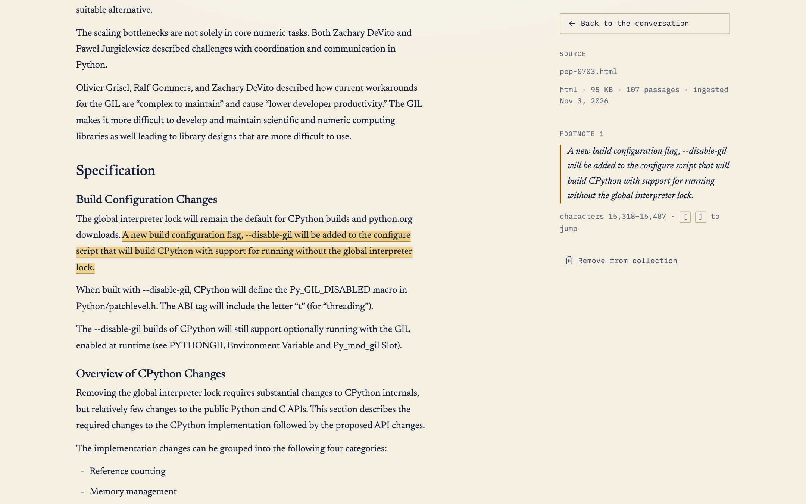
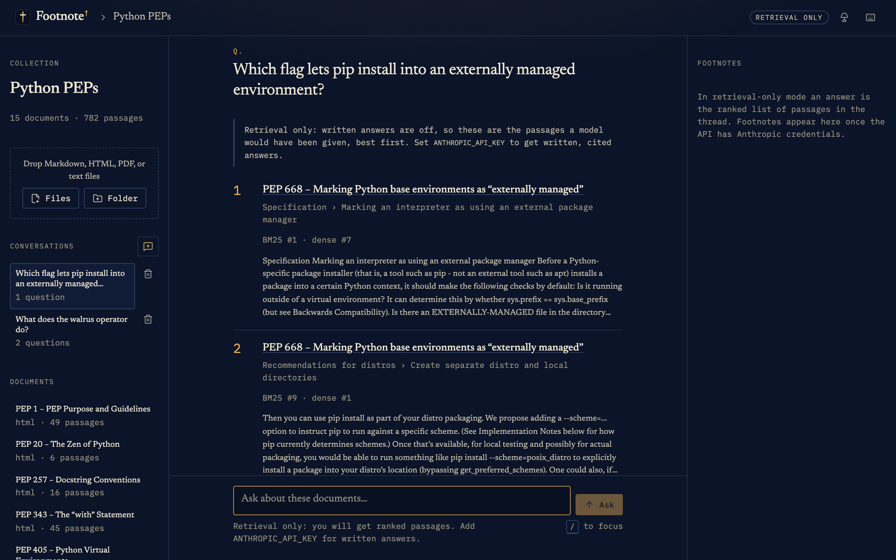
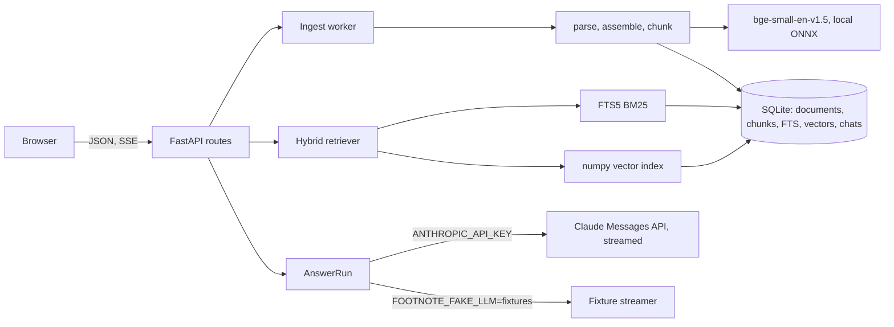
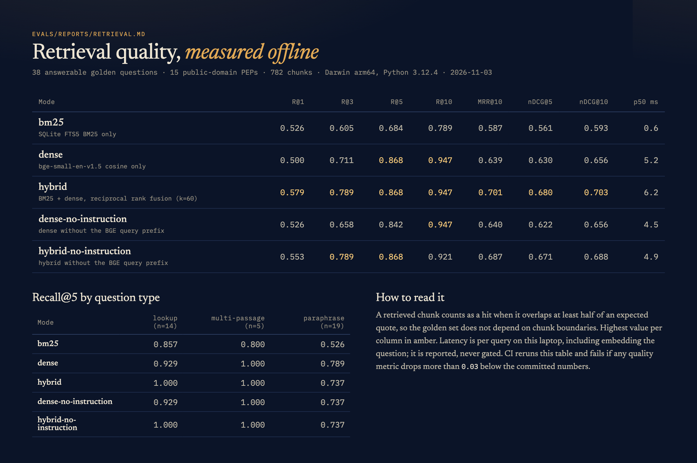

<picture>
  <source media="(prefers-color-scheme: dark)" srcset=".github/assets/banner-dark.svg">
  
</picture>

Footnote answers questions about a folder of documents, and every claim in the answer carries a footnote that opens the source at the exact sentence it rests on.

[](https://github.com/emirk35/footnote/actions/workflows/ci.yml)
[](LICENSE)
[](api/pyproject.toml)
[](web/package.json)
[](evals/reports/retrieval.md)


| Clicking a footnote opens the source, scrolled to the cited sentence | Without an API key, questions return ranked passages |
| --- | --- |
|  |  |

The answers in these screenshots come from fixture mode (`FOOTNOTE_FAKE_LLM=fixtures`), which stitches answers from retrieved sentences without calling a model, and the UI labels them that way. Retrieval, citation mapping, and highlighting are the real code paths.

## What it does

Document Q&A fails quietly. An answer that sounds right but rests on the wrong paragraph, or on nothing at all, looks the same as a good one. Footnote is built so that failure is visible:

- Each claim links to a character range in a stored document, and Footnote checks the model's quote against that range before showing the link.
- When the documents don't contain the answer, it says so instead of reaching for general knowledge.
- Retrieval quality is a number in CI rather than an impression. The [eval suite](docs/evals.md) measures recall, MRR, and nDCG against 38 golden questions on every push.

You can drop in Markdown, HTML, PDF, or plain-text files (a single file or a folder) and watch them ingest. Then ask questions, hover a footnote to read the cited passage, click it to open the page, and copy the answer as Markdown with its footnotes. Chats are saved per collection. Without an API key, everything except the written answer still works.

## Quick start

You need Python 3.12 with [uv](https://docs.astral.sh/uv/), Node 23 or later, and pnpm 9.

```sh
git clone https://github.com/emirk35/footnote.git && cd footnote
make install        # uv sync + pnpm install, from the lockfiles
make seed           # ingest 15 Python PEPs (downloads the 64 MB embedding model once)
make dev            # API on http://localhost:4410, web app on http://localhost:4411
```

Open <http://localhost:4411>. With no key the header says *Retrieval only*, and questions return ranked passages. For written, cited answers:

```sh
cp .env.example .env     # then set ANTHROPIC_API_KEY in .env
make dev
```

To see cited answers with no key and no cost, run `FOOTNOTE_FAKE_LLM=fixtures make dev`. Answers are then assembled from retrieved sentences and labeled as fixtures.

With Docker instead: `docker compose up --build`, then `docker compose exec api footnote seed`.

## Architecture



Uploads are queued to a single ingest thread. Each file is parsed into blocks, joined into one canonical text, chunked, and embedded locally, then written in one transaction (document, chunks, FTS rows, vectors). A question runs hybrid search, streams the top eight passages to Claude as citation-enabled documents, and relays the answer to the browser as server-sent events. The Next.js app renders footnotes and the document viewer from the same character offsets. [docs/architecture.md](docs/architecture.md) has the data model and sequence diagrams.

## Deep dive: grounding you can check, retrieval you can measure

### One coordinate system

Every format is parsed into structural blocks and assembled into a single canonical text. A chunk is always an exact slice of it; the chunker's property tests check that over random documents:

```python
for chunk in chunk_document(document, config):
    assert chunk.text == document.text[chunk.start : chunk.end]
    assert len(chunk.text) <= config.max_chars
```

Chunks start at headings (with consecutive headings kept together), end at block boundaries once they pass 900 characters, never exceed 1,400, and repeat up to 220 characters of trailing sentences when the next chunk continues the same section. The heading path and page range travel with each chunk.

Because chunks are slices, a citation offset inside a chunk becomes a document offset by addition. That is what lets the viewer highlight one sentence instead of a whole passage.

### Native citations, verified

Each retrieved chunk goes to Claude as its own plain-text `document` block (`answer/prompt.py`). The file and section path go in `context`, which the model sees but cannot cite:

```python
{
    "type": "document",
    "source": {"type": "text", "media_type": "text/plain", "data": passage.text},
    "title": passage.document_title,
    "context": "File: pep-0008.html\nSection: PEP 8 > Code Lay-out > Maximum Line Length",
    "citations": {"enabled": True},
}
```

The answer streams back as text blocks, and `citations_delta` events say which characters of which document support each one. Footnote does not take those offsets on trust (`answer/citations.py`):

```python
passage = self._passages[citation.document_index]
span = _locate(passage.text, citation)  # offsets must reproduce cited_text, or the quote is searched for
start = passage.start + span[0] if span else None
```

If the quote isn't in the passage at all, the footnote is shown as *unverified* and links nowhere. Two citations of the same span share a number, including when they arrive through two overlapping chunks. [ADR 0003](docs/adr/0003-citations-as-plain-text-documents.md) explains why plain-text documents won over `search_result` blocks (no `context` field, and block-granular citations) and over regex-parsed `[1]` markers.

The rest of the request (`answer/anthropic_stream.py`) uses:

- `claude-opus-5-5` with adaptive thinking and `effort: medium`, both configurable through `FOOTNOTE_MODEL` and `FOOTNOTE_EFFORT`;
- a byte-stable system prompt cached with `cache_control`;
- server-side `fallbacks: "default"`, so a safety decline is retried on the model Anthropic recommends for that category, with the switch surfaced in the UI.

`stop_reason` is checked on every answer: a `refusal` discards partial text and shows the category, and `max_tokens` keeps the text but flags it as cut off. SDK errors map, most specific first, to messages that say whether retrying will help. The stop button closes the stream, which stops generation, and the partial answer is saved as *stopped*.

### Hybrid retrieval, and what it buys

BM25 comes from SQLite FTS5. Dense vectors come from `bge-small-en-v1.5`, run locally through fastembed, so there is no second API key and retrieval works offline. The two rankings are fused with reciprocal rank fusion:

```python
for name, ranking in rankings.items():
    for position, item in enumerate(ranking, start=1):
        contributions.setdefault(item, []).append(1.0 / (k + position))
scores = {item: math.fsum(values) for item, values in contributions.items()}
```

`math.fsum` is there because a Hypothesis test caught plain `+=` making scores depend on the order of the input rankings, enough to flip near-ties.

The committed eval report, from `make eval` on an Apple Silicon laptop (macOS, arm64, Python 3.12.4), covering 15 PEPs, 782 chunks, and 38 answerable questions:

| Mode | Recall@1 | Recall@5 | Recall@10 | MRR@10 | nDCG@10 | p50 per query |
| --- | --- | --- | --- | --- | --- | --- |
| BM25 | 0.526 | 0.684 | 0.789 | 0.587 | 0.593 | 0.6 ms |
| Dense | 0.500 | 0.868 | 0.947 | 0.639 | 0.656 | 5.2 ms |
| **Hybrid (RRF, k=60)** | **0.579** | **0.868** | **0.947** | **0.701** | **0.703** | 6.2 ms |

Hybrid matches dense on recall@5 but puts the right passage first more often: MRR rises from 0.639 to 0.701. By question type, hybrid gets every lookup (BM25 0.857, dense 0.929 at k=5). It loses one paraphrase that dense alone finds, `pep405-marker`, where BM25 has nothing to contribute. It wins one lookup back, `pep668-override`, which dense ranks seventh. The BGE query instruction is worth 0.026 recall@5 for dense. The full report, misses included, is in [evals/reports/retrieval.md](evals/reports/retrieval.md):



Two of the five hybrid misses explain more than the averages do. In `pep343-protocol`, rank 2 also names `__enter__()` and `__exit__()`, so the question is answerable from what was retrieved, but the golden set lists only the abstract's sentence. In `pep405-marker`, "virtual environment" pulls in PEP 668, which discusses venvs at length, while the passage that answers it ("pyvenv.cfg", "home key") shares no vocabulary with the question. Neither has been relabelled or tuned away after the fact.

### An eval suite that survives refactoring

The golden set stores expected passages as verbatim quotes, not chunk ids. A chunk counts as relevant when it covers at least half of a quote's characters, so changing the chunker never invalidates the labels, and a quote that can't be found fails the run loudly. nDCG only rewards newly covered passages, so overlapping chunks aren't double counted.

CI runs the retrieval eval on every push, and fails if any metric drops more than 0.03 below the committed report or if hybrid recall@5 falls under 0.8. The generation eval answers each golden question and has an LLM judge label every segment and footnote. Faithfulness, citation support, citation precision, correctness, and abstention on the 8 unanswerable questions are then computed in code. It needs a key, so it runs by hand (`make eval-generation`); its logic is tested against a mocked client. Details are in [docs/evals.md](docs/evals.md).

## Design decisions

- [ADR 0001](docs/adr/0001-one-sqlite-file.md): one SQLite file holds documents, FTS5, vectors, and chats, so a re-ingest is a single transaction.
- [ADR 0002](docs/adr/0002-vector-storage.md): exact numpy search over vectors stored as BLOBs. At 100,000 chunks a query takes 3.5 ms (p50, `make bench`). sqlite-vec was rejected because extension loading depends on how Python was built.
- [ADR 0003](docs/adr/0003-citations-as-plain-text-documents.md): plain-text `document` blocks with native citations, rather than `search_result` blocks or parsed markers.
- [ADR 0004](docs/adr/0004-hybrid-retrieval.md): FTS5 BM25 plus local BGE embeddings, fused with RRF, and what the eval says about each.
- [ADR 0005](docs/adr/0005-eval-design.md): quote-based relevance, segment-level judging, and what CI gates.

## Testing

```sh
make check          # ruff, pyright (strict), ESLint, tsc, pytest, Vitest, next build
make e2e            # Playwright: two full stacks, retrieval-only and fixture mode
make eval-gate      # the retrieval eval against the committed baseline
```

The backend has 104 pytest tests. They cover parsers on fixture documents (including a PDF generated in the test, so no binaries are committed), chunker edge cases and Hypothesis properties, the RRF math, incremental re-ingest, the HTTP routes, SSE ordering and the stop path, the exact request sent to the SDK, citation mapping and verification, refusal, `max_tokens`, and fallback handling, every SDK error class, and the eval metrics against hand-computed values. The web app has 24 Vitest tests: stream parsing, the answer reducer, footnote layout, copy-as-Markdown, and the rendered superscripts and hover cards. Three Playwright tests run against real API processes, one retrieval-only and two in fixture mode. No test calls the Anthropic API.

```text
api/                 FastAPI service, the `footnote` CLI, tests
  src/footnote/
    ingest/          parsers, canonical document, chunker, incremental pipeline
    retrieval/       FTS5 BM25, local embeddings, vector index, RRF
    answer/          prompt, Claude streamer, fixture streamer, citations, error mapping
    evals/           golden set, metrics, retrieval and generation runners, judge
    server/          app factory, routes, ingest jobs
web/                 Next.js app (library, workspace, document viewer), Vitest, Playwright
evals/               corpus (public-domain PEPs), golden.jsonl, committed reports
docs/                architecture, evals, ADRs
```

## Roadmap

- **Follow-up questions.** Retrieval uses only the latest question, so "and what about tabs?" retrieves poorly. Rewriting the query with the conversation is the next change, measured by adding follow-up items to the golden set.
- **Reranking.** A cross-encoder over the fused top 50, kept only if it closes the paraphrase gap in the eval without blowing the latency budget.
- **Golden set breadth.** 38 questions means one question moves recall@5 by 0.026. Add non-PEP documents, PDFs, and questions with more than one valid supporting passage.
- **Incremental vector cache.** The cache reloads a collection's whole matrix after each ingest, which takes 0.4 s at 100,000 chunks. Appending in place would remove that pause.

## License

MIT, see [LICENSE](LICENSE). The bundled PEPs are public domain or CC0; see [evals/corpus/LICENSE.md](evals/corpus/LICENSE.md).
