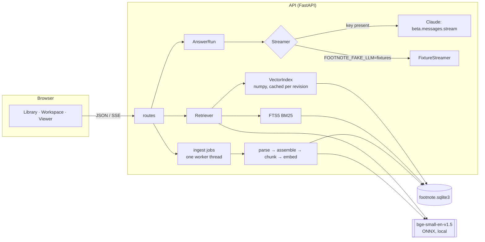
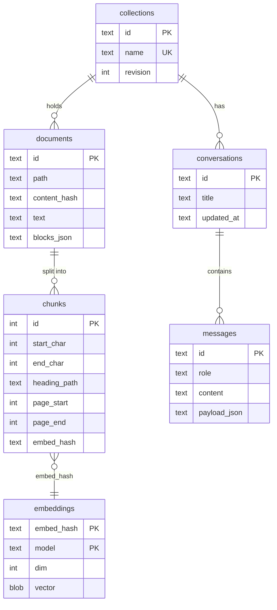
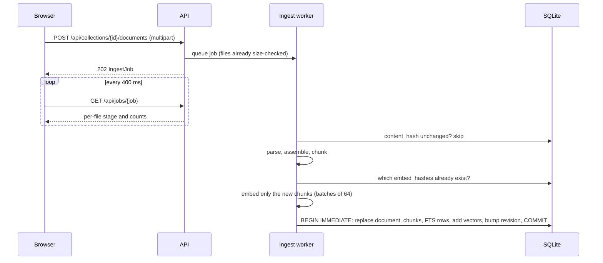
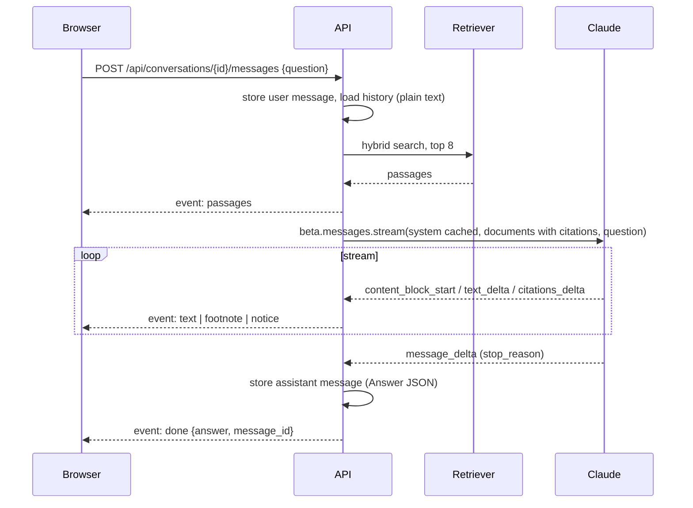

# Architecture

Footnote is two processes. The API (`api/`, Python 3.12, FastAPI) owns parsing,
storage, retrieval, and the conversation with Claude. The web app (`web/`, Next.js App
Router, React 19) is a client that talks to it over JSON and server-sent events. The
browser calls the API directly; the Next.js server only renders pages and tells the
client where the API is (`FOOTNOTE_API_URL`, read per request so one build works behind
any address).

Without credentials, `Streamer` is `None` and the answer endpoint returns the ranked
passages instead (retrieval-only mode).

## The document model

Every format goes through the same two steps.

1. A parser (`ingest/parsers.py`) turns bytes into a flat list of blocks: headings with a
   level, paragraphs, list items, code, quotes, table rows, and definition terms. PDFs
   add a page number to each block, and outline bookmarks become headings.
2. `assemble` joins the blocks with a blank line between them into one **canonical
   text** and records each block's `[start, end)` offsets.

The canonical text is what gets chunked, what is sent to the model, what citations
point into, and what the viewer renders block by block. Inline markup (bold, links) is
dropped on purpose, because the model cites the canonical text verbatim and the viewer
has to be able to highlight exactly that.

## Data model

`chunks_fts` is an FTS5 external-content table over `chunks(text, heading_path)`,
maintained by insert and delete triggers. `collections.revision` increments on every
change to a collection's chunks; the in-memory vector cache compares it to decide when
to reload. An assistant message's `payload_json` is the full `Answer` (segments,
footnotes, passages, status), so a reloaded conversation renders identically to the
live stream.

## Ingest

Two hashes make re-ingest cheap. The file's SHA-256 skips unchanged files before they
are parsed: re-running `footnote seed` over the 15-PEP corpus takes 0.33 s. Each chunk's
embedding input (title, section path, and text) is also hashed, so editing one paragraph
re-embeds one chunk. `test_editing_one_paragraph_re_embeds_only_the_changed_chunks`
pins this behaviour.

### Chunking

`ingest/chunker.py` packs units into chunks. A unit is a sentence of prose, a group of
lines of oversized code, or a whole short block. The rules:

- a heading always starts a new chunk, and consecutive headings stay with the content
  that follows them;
- a chunk ends at a block boundary once it reaches `target_chars` (900), and never
  exceeds `max_chars` (1400);
- up to `overlap_chars` (220) of trailing sentences repeat at the start of the next
  chunk, but only within the same section.

Hypothesis property tests check, over random documents, that every chunk is an exact
slice of the text, that every non-space character is in some chunk, and that no chunk
straddles a heading.

## Asking a question

The request to Claude (`answer/anthropic_stream.py`):

- `model` from `FOOTNOTE_MODEL` (default `claude-opus-5-5`), `thinking: adaptive`,
  `output_config.effort` from `FOOTNOTE_EFFORT` (default `medium`, set explicitly
  because that is also Opus 5.5's own default and the choice should be visible);
- the system prompt as a single text block with `cache_control: ephemeral`, byte-stable
  across requests;
- history turns as plain strings, then one user turn with a `document` block per passage
  (citations enabled on all) followed by the question;
- `fallbacks: "default"` with the `server-side-fallback-2026-07-01` beta, so a safety
  decline is retried server-side on the model Anthropic recommends for that category;
- no `temperature`, `top_p`, or `top_k` (rejected on API version 2026-10-21, which the
  2.x SDK sends) and no `output_config.format` (incompatible with citations).

`AnswerRun` (`answer/generate.py`) consumes the four raw stream event types. Each
`text` content block becomes a segment; each `citations_delta` is resolved by
`FootnoteBook` into a numbered, verified footnote attached to the segment it arrived on.
`stop_reason` decides the final status: `refusal` discards partial text and records the
category, `max_tokens` keeps the text and flags truncation. A `fallback` content block,
or a `message_start` that names a different model (sticky fallback routing), becomes a
notice in the UI. SDK exceptions are mapped most-specific-first (authentication,
permission, not found, rate limit, overloaded, request too large, bad request, other
status, timeout, connection) into an `error` event that says whether retrying makes
sense.

### Stopping

The stop button aborts the browser's `fetch`. Starlette sees the disconnect and cancels
the response generator; the cancellation unwinds through the SDK's stream context
manager, which closes the HTTP connection to the API, so generation (and billing) stops.
On the way out, the generator saves what had streamed with status `stopped`.
`test_a_stopped_stream_saves_the_partial_answer` drives this path directly.

## The web client

- `lib/sse.ts` parses `text/event-stream` from a `ReadableStream`. `EventSource` cannot
  POST.
- `lib/answer.ts` holds the pure logic: `applyEvent` folds stream events into a draft,
  and `layoutAnswer` turns segments into paragraphs, lists, and code with footnote
  markers in place. A marker that lands after a paragraph break is pulled back onto the
  text it cites. `answerToMarkdown` produces copy-as-Markdown with `[^n]` footnotes.
- `lib/viewer.ts` intersects a highlight range with each block's offsets.
- Components: `Workspace` (collection rail, thread, footnote rail), `Turn`,
  `AnswerBody`/`FootnoteRef` (superscripts with hover and focus cards), `UploadPanel`,
  `DocumentViewer`.

## Fixture mode

`FOOTNOTE_FAKE_LLM=fixtures` swaps in `FixtureStreamer`. It picks the one or two
retrieved sentences that cover the most question terms (the second only from the same
document as the first, so a shared keyword can't drag in an unrelated source), and
streams them back verbatim, one footnote each, as SDK event objects
(`BetaRawContentBlockDeltaEvent` with `BetaCitationsDelta`, and so on). Everything
downstream of the SDK runs unchanged. It abstains when no sentence covers at least half
of the question's content words. The UI labels these answers "Fixture answer · no model
call", and the header badge reads "Fixture answers". It exists for development, the
Playwright suite, and the screenshots; it is not a model and never presented as one.
